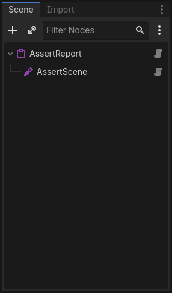
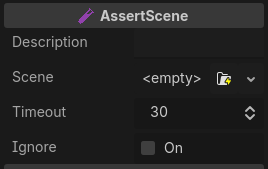

# Getting Started

## Creating a Test
- Create a scene to be tested
- Add as many `assert()` you wanto to validate if everything is working right
- End the scene with `get_tree().quit()`

!!! note
    Notice how we didn't use any feature from the addon to create the test.  
    
    - Our scene doesn't have a `Node` from the addon
    - Our files doesn't need prefix/suffix `test`
    - Our methods doesn't need prefix/suffix `test`
    - Our script doesn't have to `extend` an addon script
    - Our script doesn't call method from the addon
    
    The test is just a scene that close itself!  

## Running a Test
The first step is to create a scene which will be responsible for running your test scenes:  

<figure markdown="span">

</figure>

These two nodes are essential:  

- `AssertReport`, which initiate the children tests and print their results  
- `AssertScene`, which run the test scene in a new process  

Access your `AssertScene` properties and put your test scene in the `scene` property.  

<figure markdown="span">

</figure>

Save this scene and execute it to start the tests.
