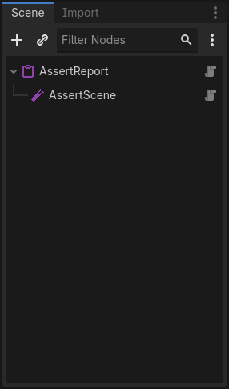
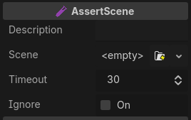
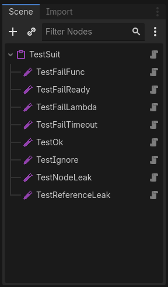
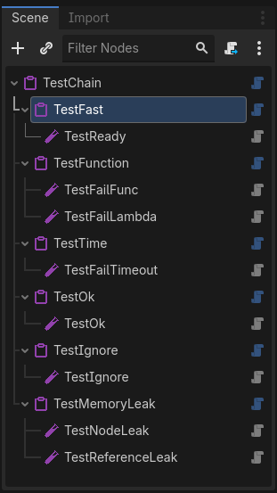
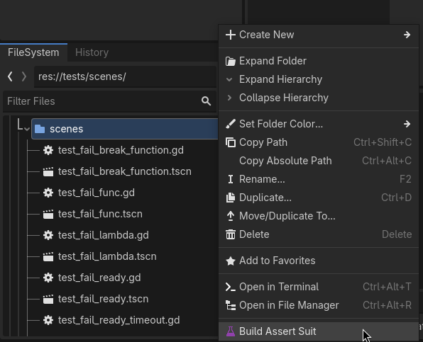

# Tutorial

## Creating a test
- Create a scene to be tested
- Add as many `assert()` you wanto to validate if everything is working right
- End the scene with `get_tree().quit()`

!!! note
	Notice how we didn't use any feature from the addon to create the test.  
	
	- Our scene doesn't have a `Node` from the addon
	- Our files doesn't need prefix/suffix `test`
	- Our methods doesn't need prefix/suffix `test`
	- Our script doesn't have to `extend` an addon script
	- Our script doesn't call method from the addon
	
	The test is just a scene that close itself!  

## Running a test
The first step is to create a scene which will be responsible for running your test scenes. It should have an `AssertReport` with one or more `AssertScene` as children.  

<figure markdown="span">

</figure>

!!! info 
	- `AssertReport` initiate the children tests and print their results  
	- `AssertScene` run the test scene in a new process  

Access your `AssertScene` properties and put your test scene in the `scene` property.  

<figure markdown="span">

</figure>

Save this scene and execute it to start the tests! Your output should be something like:  

=== "No error"
	```
	(OK) Test description here
	(1 OK, 0 FAIL)
	```

=== "Assert fail"
	```
	(FAIL) Test description here
		SCRIPT ERROR: Assertion failed: assert message here
				...
	
	(0 OK, 1 FAIL)
	```

=== "Timeouted"
	```
	(FAIL) Test description here --- Scene halted after exceeding time limit
	
	(0 OK, 1 FAIL)
	```

=== "Memory leak"
	```
	(FAIL) Test description here
		WARNING: 1 ObjectDB instance was leaked at exit (run with `--verbose` for details).
			at: cleanup (core/object/object.cpp:2536)
	
	(0 OK, 1 FAIL)
	```

It's basically the result of your test scene and the [stderr](https://en.wikipedia.org/wiki/Standard_streams#Standard_error_(stderr)) messages.  

## Running multiple tests
To run multiple tests, just add more `AssertScene` to your scene.  

<figure markdown="span">

</figure>

If you have **many** tests and wants to organize them, you can put `AssertReport` inside `AssertReport`.  

<figure markdown="span">

</figure>

In case you already have a directory with your test scenes (I don't know when this would happen), you can build the assert suit scene by right clicking the directory and selecting "Build Assert Suit".  

<figure markdown="span">

</figure>
